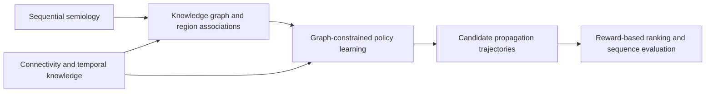

# KGRL

## Uncovering Epileptic Seizure Propagation Using Knowledge Graph-based Reinforcement Learning

**Shihao Yang\*, Zirui Wen\*, Erafat Rehim, Vasileios Kokkinos, Alexander Weil, Yen-Cheng Shih, Yo-Tsen Liu, and Feng Liu**

\* Equal contribution

[Method](#method) · [GPU setup](#gpu-setup) · [Experiments](#experiments-and-results) · [Citation](#citation)

Research code accompanying our paper. KGRL models seizure propagation as a sequence of decisions over a knowledge graph, connecting observed semiology with plausible brain-region trajectories. The framework combines structured clinical knowledge, anatomical connectivity, and temporal consistency to guide reinforcement learning and path inference.

## Method



The implementation includes a GRU actor-critic, PPO with curriculum training, graph and temporal reward components, region-belief reasoning, and sequence-based evaluation. DQN, behavioral cloning, non-learning baselines, and component ablations share the same environment and scoring interface.

## GPU setup

The GPU execution profile uses **Python 3.10**, **PyTorch 2.11 with CUDA 12.8**, NumPy, pandas, and Matplotlib. The historical full-run reference workstation has a **single NVIDIA RTX A6000 with 48 GB VRAM**.

```bash
git clone https://github.com/Rutgers-NINC-Lab/Knowledge-graph-RL.git
cd Knowledge-graph-RL
python -m pip install torch==2.11.0 --index-url https://download.pytorch.org/whl/cu128
python -m pip install -r requirements.txt
```

CUDA installation details are available in the [official PyTorch installation guide](https://pytorch.org/get-started/previous-versions/). The distributed configuration selects `cuda` by default; `KGRL_DEVICE=cuda:0` selects a particular GPU.

### Run the implementation

```bash
# Training, checkpoint reload, inference, and evaluation
python run_demo.py

# Baselines, ablations, decoding comparisons, diagnostics, and result analysis
python scripts/run_experiments.py
```

The repository includes a synthetic input generator so that these workflows can be executed independently. **`configs/example.json` contains illustrative settings, not the paper's tuned hyperparameters.** Original clinical records, trained embeddings, and pretrained checkpoints are not distributed. The example outputs demonstrate the computations rather than reproduce the paper's clinical numerical results.

On Windows, `RUN_DEMO.ps1` runs the core workflow and `RUN_DEMO.ps1 -Experiments` runs the experiment suite. Add `-Python 'C:\path\to\python.exe'` to select an interpreter.

## Experiments and results

Experiment runners are separated from result aggregation and plotting. Run the baseline experiment first to create the shared checkpoints and candidate paths:

```bash
python -m scripts.experiments.baselines
python -m scripts.experiments.ablations
python -m scripts.experiments.decoding
python -m scripts.experiments.diagnostics
```

Paths below are relative to `scripts/`.

| Paper item | Experiment | Result analysis |
|---|---|---|
| Table 1 | `experiments/baselines.py` | `results/comparison_tables.py` |
| Table 2 | `experiments/ablations.py` | `results/comparison_tables.py` |
| Table 3 | `experiments/decoding.py` | `results/comparison_tables.py` |
| Tables 4(a,b) and 5 | Saved baseline paths | `results/case_analysis.py` |
| Figures 3-5 | Knowledge and annotation inputs | `results/knowledge_analysis.py` |
| Figure 7 | `experiments/diagnostics.py` | `results/diagnostics.py` |
| Figure 8 | Saved baseline candidates | `results/diagnostics.py` |

Result modules can be rerun without retraining, for example `python -m scripts.results.comparison_tables`. Intermediate paths, checkpoints, and logs are written to `outputs/experiments/`; final tables and figures are written to `outputs/results/`.

### Full-study runtime reference

Budget approximately **1-2 days for the complete study-scale workflow on one GPU**, including baseline training, ablations, decoding, and diagnostic sweeps. This is a planning estimate informed by archived full training runs, rather than a timing of the small distributed example. See [runtime assumptions](docs/RUNTIME.md) for the recorded training ranges and the scope of this estimate.

## Repository guide

```text
configs/example.json        Illustrative configuration
src/kgrl/                   Core learning, graph, reward, and evaluation modules
scripts/experiments/        Baseline, ablation, decoding, and diagnostic experiments
scripts/results/            Statistical summaries, tables, and plots
scripts/generate_sample_data.py
scripts/run_experiments.py
run_demo.py
```

Generated inputs, results, model files, caches, and the journal reproducibility report are excluded from version control. The original KGRL algorithm modules retain their source provenance in `docs/source_manifest.json`.

## Citation

If you find this work useful in your research, please consider citing our paper:

```bibtex
@article{yang2026uncovering,
  title={Uncovering Epileptic Seizure Propagation Using Knowledge Graph-based Reinforcement Learning},
  author={Yang, Shihao and Wen, Zirui and Rehim, Erafat and Kokkinos, Vasileios and Weil, Alexander and Shih, Yen-Cheng and Liu, Yo-Tsen and Liu, Feng},
  journal={IISE Transactions},
  year={2026},
  publisher={Taylor \& Francis}
}
```

## License

Released under the [MIT License](LICENSE). This repository provides research software for investigating seizure propagation.
